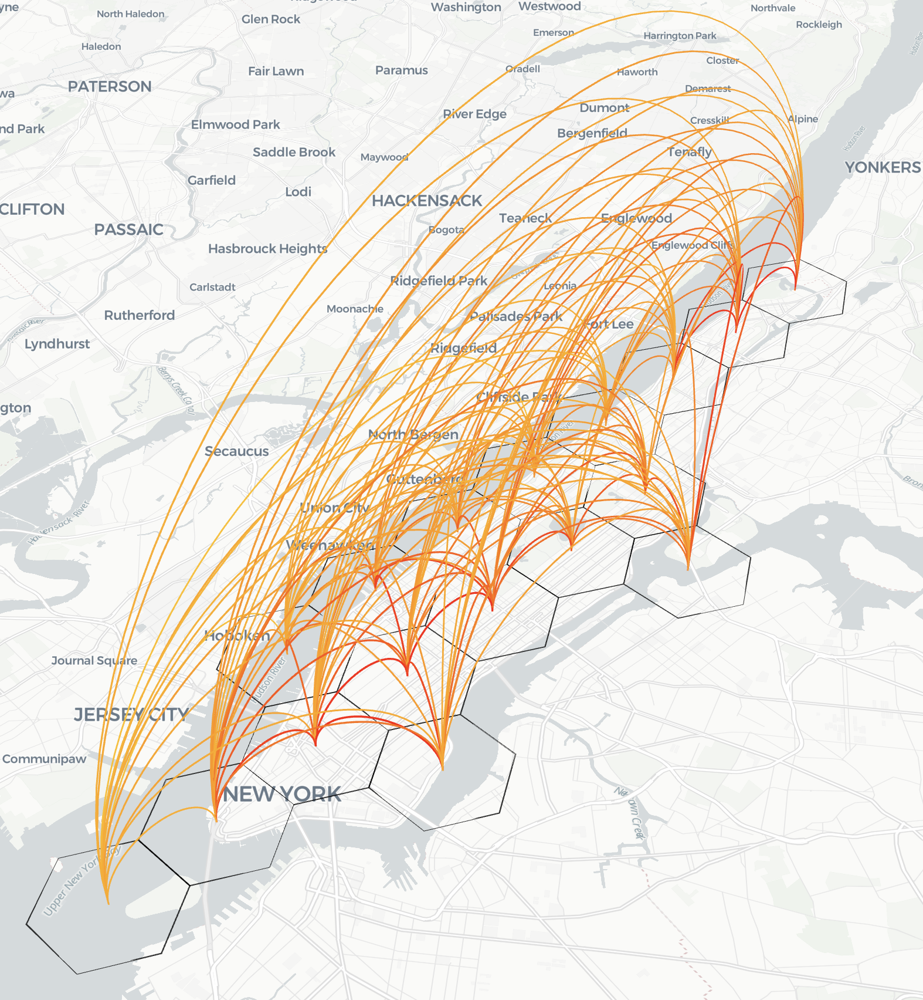
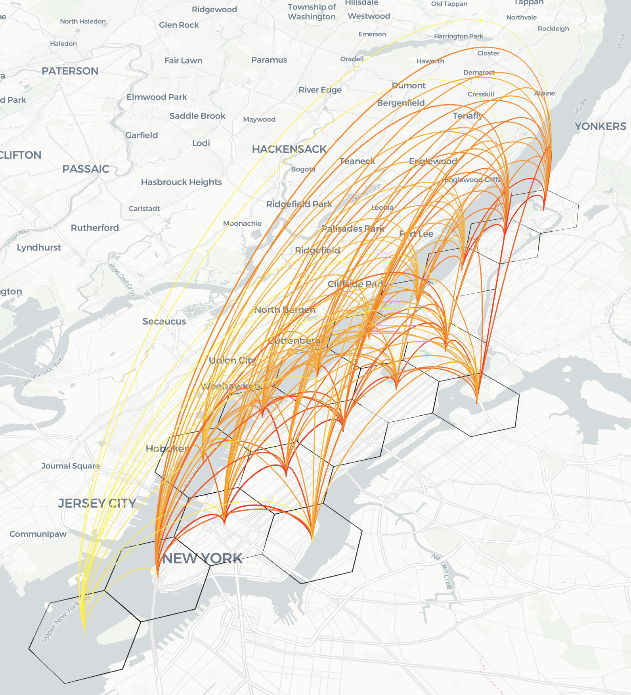

<div align="center">

# uTECH-GenUrban

### From demographic cohorts to daily activities and urban mobility

A three-agent, hybrid generative–predictive workflow for urban analysis.

[Paper](https://openreview.net/forum?id=tFam4451mK) · [Quick start](#quick-start) · [Input guide](docs/INPUTS.md) · [Reproducibility](docs/REPRODUCIBILITY.md)

</div>


## The workflow

uTECH-GenUrban connects demographic context, activity schedules, and the built
environment to origin–destination (OD) flow prediction. Large language models
generate structured intermediate representations; a Gradient Boosting Regressor
(GBR) produces the final numerical flow predictions.

| Stage | Input | Output |
|:--|:--|:--|
| **PopulationAgent** | American Community Survey (ACS) county marginals | Demographic cohorts with population counts and behavioral descriptions |
| **ActivityAgent** | Generated cohorts | A 24-hour profile over sleep, work, meal, errand, and leisure for each cohort |
| **PlannerAgent** | City, time context, and cohort activity summaries | Commute, leisure, and home mobility-force features |
| **OD predictor** | Mobility forces, training-derived spatial features, buildings, and temporal context | Predicted OD flows and evaluation metrics |

Population and activity generation include a verification wrapper: deterministic
checks, self-review and repair, role-based discussion, and a referee decision.
This wrapper is part of the workflow—not a separate experiment in this release.
Structural checks assess properties such as population totals, identifiers, and
activity-share constraints; passing them does not establish real-world behavioral
accuracy.

## What this repository contains

This is a **code-only release of the original notebook workflow**, with portable
configuration and narrowly scoped runtime fixes. The command-line runner executes
the same notebook; it is not a second implementation of the model.

```text
.
├── MulitiCityStudy.ipynb       # Original generation and prediction workflow
├── run_workflow.py            # Preflight checks and notebook execution
├── workflow_config.py         # Private settings and input validation
├── Utl.py                     # ACS and building-processing helpers
├── requirements.txt           # Runtime dependencies
├── .env.example               # Empty, user-supplied configuration fields
├── docs/
│   ├── INPUTS.md              # Private input layout and schemas
│   ├── REPRODUCIBILITY.md     # Protocol scope and implementation notes
│   └── images/               # Selected manuscript illustrations
└── tests/                    # Offline code checks
```

Raw data, generated agent JSON, OD predictions, execution logs, and stored notebook
outputs are not distributed. Additional comparison and ablation code is also
excluded. The manuscript illustrations in this README are documentation
assets, not a bundled results dataset.

## Quick start

### 1. Create an environment

Use Python 3.10–3.12. This workflow uses the legacy AutoGen 0.2 agent API;
install the declared dependencies rather than substituting the newest AutoGen API.

```bash
python -m venv .venv
```

Activate the environment using your shell, then install the dependencies:

```bash
python -m pip install -r requirements.txt
```

### 2. Supply your configuration

Copy `.env.example` to `.env` and fill in your own settings. No credentials,
provider endpoint, or model identifier is supplied by this repository.

| Variable | Purpose |
|:--|:--|
| `LLM_API_KEY` | Your LLM provider credential |
| `LLM_BASE_URL` | Your compatible LLM endpoint |
| `GENURBAN_MODELS` | Comma-separated model identifiers accepted by your provider |
| `GENURBAN_WORKSPACE` | Private working directory; defaults to `private_workspace` |
| `GENURBAN_CITIES` | Optional comma-separated selection of configured cities |
| `GENURBAN_PLOTS` | Set to `1` to enable optional interactive workflow plots |
| `CENSUS_API_KEY` | Census credential, if fetching missing ACS inputs |
| `CENSUS_API_BASE_URL` | User-configured Census endpoint, if fetching missing ACS inputs |

Configured city names are `NYC`, `Las Vegas`, `San Francisco`, and `Minneapolis`.
Choose a small city/model subset for an initial run. Each selected combination
invokes the complete workflow and can incur provider charges.

Keep `.env` private. The repository's ignore rules exclude credentials and the
default private workspace; do not force-add either to version control.

### 3. Prepare private inputs

Place your ACS tables, OD files, zone boundaries, and building inputs in
`private_workspace`, following the [input guide](docs/INPUTS.md). Existing ACS
tables can be used without a Census request. Input data are not included and must
be obtained under the appropriate provider terms.

### 4. Check before running

```bash
python run_workflow.py --check
```

Preflight is local and does not make network requests or spend LLM tokens. It
does not test whether your credentials or chosen model are accepted by a provider.

### 5. Execute the workflow

```bash
python run_workflow.py
```

This command executes the notebook and may contact the configured services.
Runtime outputs are written within the private workspace and are not repository
contents. Inspect the run status and diagnostics before interpreting metrics.

For interactive work, launch JupyterLab from the repository root and open
`MulitiCityStudy.ipynb`. Configure the same environment and private inputs first.

## A view from the paper

### Manhattan: observed and predicted OD flows

| Observed TomTom flows | Complete-model predictions |
|:--:|:--:|
|  |  |

*Observed Manhattan OD corridors (left) and a representative complete-model
prediction (right), reproduced from the paper. Curves connect origin and
destination zones; black polygon boundaries delineate the OD zones. This is a
qualitative spatial comparison, not a substitute for quantitative evaluation or
evidence of generalization to unseen cities or seasons.*

The illustration is retained from the paper and was not generated by a new run of
this release. In particular, the original notebook uses file-level flow
aggregation and filename-derived temporal context. The later controlled hourly
evaluation uses a different observation construction. This release does not claim
to reproduce every numerical result in the current manuscript. See
[Reproducibility and scope](docs/REPRODUCIBILITY.md) for the exact distinction.

## Development checks

```bash
python -m unittest discover -s tests
```

These offline checks exercise code behavior without provider access or private
research data. They do not substitute for an end-to-end study with real inputs.

## Reference

**uTECH-GenUrban: A Generative Agent-Based Framework for Urban Planning and Mobility
Analytics** — [OpenReview paper and discussion](https://openreview.net/forum?id=tFam4451mK).

Please consult the paper for the experimental context and limitations. No software
license is declared in this release; contact the authors regarding reuse terms.
